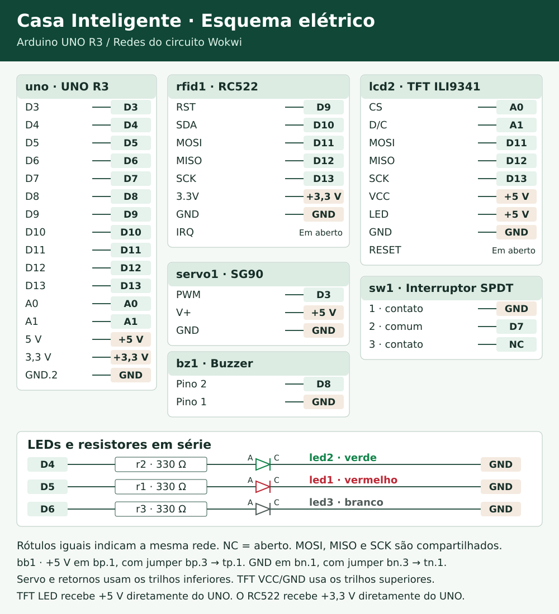

# Casa Inteligente

**SENAI · Internet das Coisas · 2026**

Pietro Ramos Tamanini e Henrique Nau

Protótipo de automação residencial com Arduino UNO R3, controle de acesso por RFID, iluminação da sacada e interface local em um TFT ILI9341 de 320 × 240 pixels.

[Documentação Técnica - SA (PDF)](docs/Documentacao_Casa_Inteligente.pdf) · [Documento editável](docs/Documentacao_Casa_Inteligente.docx) · [Simulação no Wokwi](https://wokwi.com/projects/480424726963886081)

## Objetivo e funcionalidades

O projeto integra identificação, atuação e monitoramento local em uma demonstração de automação residencial para a unidade curricular de Internet das Coisas.

- O leitor RC522 concede acesso à TAG `01:02:03:04` e sinaliza a recusa de outros cartões.
- O servo SG90 abre a porta a 90° e retorna a 0° após cinco segundos da última autorização.
- Os LEDs verde e vermelho e o buzzer indicam o resultado da leitura.
- O interruptor controla o LED branco que representa a iluminação da sacada.
- O ILI9341 apresenta os estados da porta e da iluminação, além de avisos de acesso.

## Componentes

Um Arduino UNO R3, um TFT ILI9341, um leitor RC522, um servo SG90, três LEDs (verde, vermelho e branco), três resistores de 330 Ω, um interruptor deslizante, um buzzer piezoelétrico, uma meia protoboard, fios e cartões RFID para teste. A [lista de componentes](docs/componentes.md) relaciona os identificadores do Wokwi.

## Esquema elétrico e pinagem



[Versão em PNG](imagens/esquematico.png) · [Pinagem completa](docs/pinagem.md)

| Arduino UNO | Conexão |
| --- | --- |
| D3 | Servo PWM |
| D4 | Resistor r2 e LED verde |
| D5 | Resistor r1 e LED vermelho |
| D6 | Resistor r3 e LED branco |
| D7 | Comum do interruptor em INPUT_PULLUP |
| D8 | Buzzer pino 2 |
| D9 | RC522 RST |
| D10 | RC522 SDA/SS |
| D11 | MOSI do RC522 e do TFT |
| D12 | MISO do RC522 e do TFT |
| D13 | SCK do RC522 e do TFT |
| A0 | TFT CS |
| A1 | TFT D/C |
| 5 V | V+ do servo, VCC e LED do TFT no Wokwi |
| 3,3 V | Alimentação do RC522 |
| GND.2 | Terra comum dos módulos, LEDs, buzzer e interruptor |

O RC522 e o TFT compartilham o SPI com pinos CS independentes. Para montagem física, confira as tensões e a compatibilidade dos sinais de cada módulo antes de usar as ligações da simulação. Os cuidados de alimentação e conversão de nível estão na seção de esquema elétrico do PDF.

## Software e bibliotecas

O firmware é escrito em C++ para Arduino. O SPI faz parte do núcleo Arduino AVR. O arquivo [libraries.txt](libraries.txt) lista MFRC522, Servo, Adafruit ILI9341 e Adafruit GFX Library.

## Como simular

1. Abra o [projeto no Wokwi](https://wokwi.com/projects/480424726963886081) e clique em **Start Simulation**.
2. Clique no módulo RC522 e apresente o cartão azul, UID `01:02:03:04`. Observe o LED verde, o buzzer, o servo e o TFT.
3. Aguarde cinco segundos e observe o fechamento. Apresente outro cartão e observe a sinalização de recusa.
4. Mova o interruptor e compare o LED branco com o painel **LUZ DA SACADA**. O monitor serial registra as leituras a 9.600 bit/s.

O [roteiro de testes](docs/testes.md) registra a validação realizada e os casos funcionais.

## Estrutura e versionamento

```text
Casa-Inteligente/
├── sketch.ino           Firmware Arduino
├── diagram.json         Circuito Wokwi
├── libraries.txt        Bibliotecas do simulador
├── docs/                PDF, DOCX e notas técnicas
├── imagens/             Esquema em SVG e PNG
├── .gitignore
└── README.md
```

A branch `main` mantém o código, o circuito e a documentação no [repositório GitHub](https://github.com/PietroTamanini/Casa-Inteligente). Os arquivos do Wokwi ficam na raiz.
